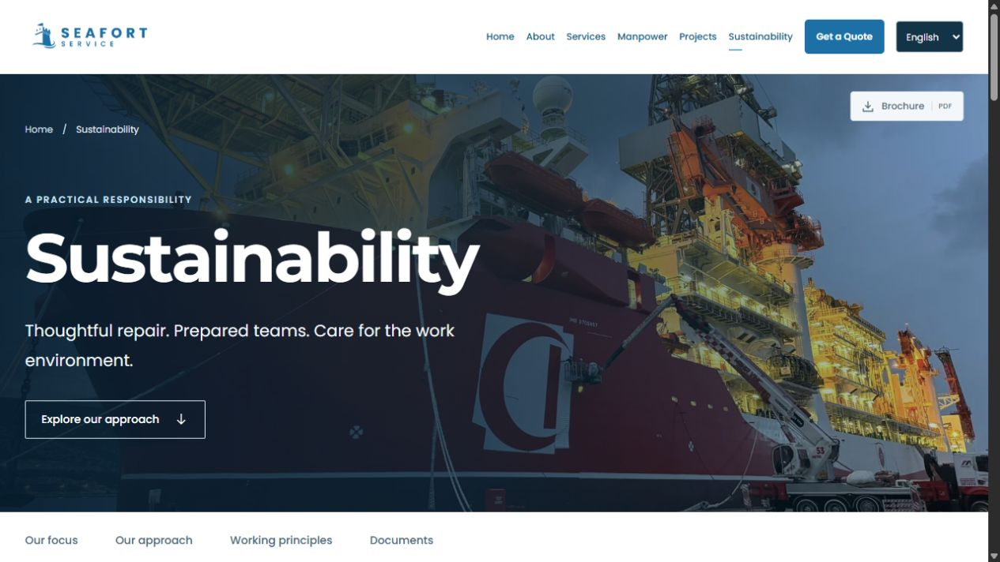

# Seafort Website

Seafort’un güncel bağımsız PHP web sitesi ve içerik yönetim paneli. **Sürüm 1.3.1** projesi [website](website/) klasöründedir.



## Güncel proje

- PHP 8.2+, veritabanı ve npm gerektirmeyen yapı.
- Blog, projeler, slider, sayfa metinleri ve görseller için yönetim paneli.
- Sayfaya özel veya genel PDF broşürü; adminden değiştirilebilir WhatsApp ve sosyal hesaplar.
- İngilizce ana dil; Türkçe, Arapça, Rusça ve sadeleştirilmiş Çince seçenekleri.
- Sustainability, FPU çelik işleri, rigging/oilfield, tersane ve gemi inşa desteği sayfaları.
- Yerel görseller, Poppins/Montserrat fontları ve İngilizce tanıtım videosu.

**[Çalıştırma ve kurulum kılavuzu](website/README.md)** · [Yayındaki önizleme](https://preview.seafortservice.com/sustainability/)

## Yerelde çalıştırma

Repo kökünde:

```sh
php website/tools/setup.php
php -S 127.0.0.1:8082 -t website/public_html website/tools/router.php
```

Tarayıcıda <http://127.0.0.1:8082> adresini açın. Windows/XAMPP komutları kurulum kılavuzundadır.

Yönetici şifreleri, canlı ayarlar, özel çalışan kayıtları, taslak yazılar ve yüklenen dosyalar repoda bulunmaz. Kurulum yalnızca yayımlanmış başlangıç içeriğini kopyalar; mevcut içerikleri değiştirmez.

## Önceki statik site

Kök dizindeki HTML/CSS/JavaScript dosyaları ve mevcut GitHub Pages yayını korunmuştur. PHP uygulaması GitHub Pages üzerinde çalışmaz; `website/public_html` kökünü kullanan PHP destekli bir sunucu gerekir.

[Önceki sürümün açıklaması ve kontrolleri](docs/legacy-static-site.md).
