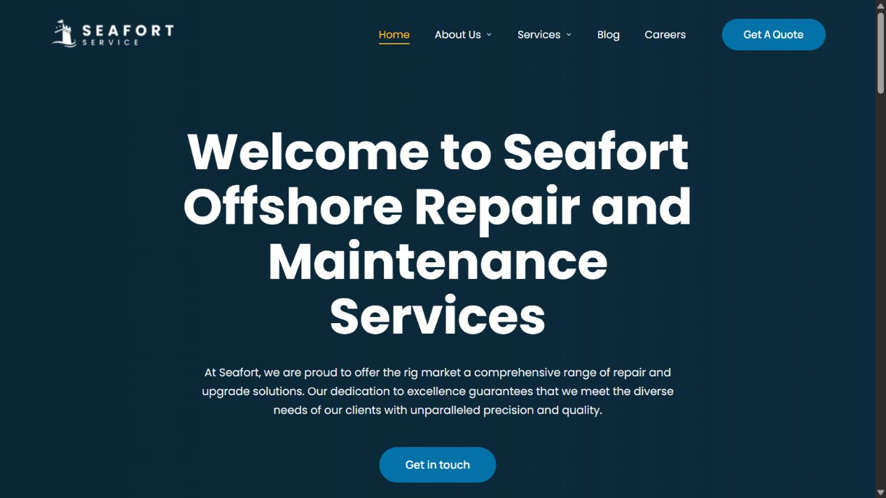

# Seafort Frontend


[](https://github.com/ahmetsn34/Seafort_Frontend/actions/workflows/check.yml)

A responsive, multi-page frontend for a maritime services company, built with HTML, CSS, and vanilla JavaScript. The site presents offshore repair, ship construction, supply services, facilities, and company information.



## What is included

- Ten static pages covering the home page, services, values, team, Filyos facilities, references, blog, and contact / careers.
- Desktop dropdown navigation and a mobile menu with ARIA state updates and Escape-key handling.
- Animated counters, a client-logo strip, and a scroll-to-top button.
- Quote and careers form layouts.

## Local preview

No package installation or build step is required. With Python 3 installed, run:

```bash
git clone https://github.com/ahmetsn34/Seafort_Frontend.git
cd Seafort_Frontend
python -m http.server 8000 --bind 127.0.0.1
```

Open [http://127.0.0.1:8000](http://127.0.0.1:8000). On systems where Python 3 is named `python3`, use that command instead.

## Current scope

The quote and careers forms are interface demos: JavaScript prevents submission and displays a status message. There is no email delivery, CV upload service, database, or backend in this repository. The forms use `novalidate`; production use needs validation and a submission endpoint.

Blog article and pagination links currently use `#` placeholders. Database-related HTML comments describe possible future integration rather than a working data layer.

Most logos and photos load from `seafortservice.com`; fonts load from Google Fonts. Their appearance depends on network access and those external services. The optional `assets/img/hero.jpg` is not bundled; the home hero uses its dark background fallback until an image is supplied. See [image guidance](../assets/img/README.txt).

## Project structure

```text
index.html                  Home page
*.html                      Service and company pages
assets/css/style.css        Shared styles and responsive layout
assets/js/main.js           Navigation, animations, and demo forms
assets/img/README.txt        Local image guidance
scripts/check_site.py       Local link and asset checks
.github/workflows/check.yml  Automated static checks
```

## Checks

```bash
python scripts/check_site.py
```

The dependency-free check validates local HTML links, fragment targets, and referenced HTML / CSS assets with case-sensitive paths. It reports the optional missing hero image and `#` placeholders separately. External URLs are not requested; browser behavior and remote image availability need a browser review. GitHub Actions runs this check on pushes and pull requests.
